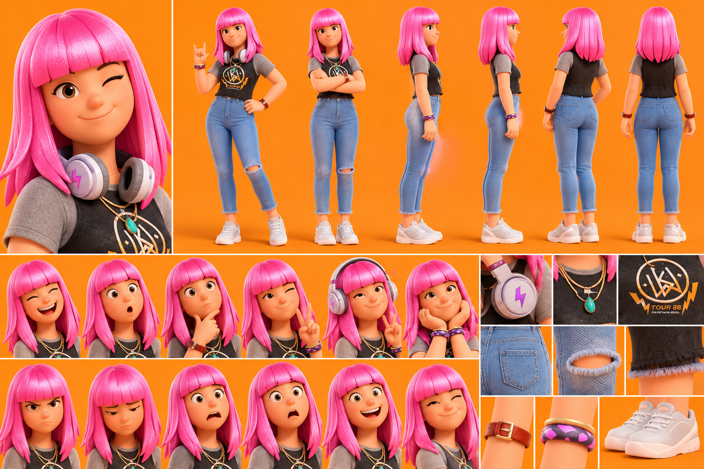

# L'Ado — Luna

La planche sert à garder **tous les détails, toujours**. On ne change rien au dessin.

## Rôle
- Représente la génération adolescente et ses préoccupations.
- Apporte un regard moderne sur les tendances et les réseaux sociaux.
- Crée des situations humoristiques avec ses parents.
- Illustre les conflits générationnels et les différences de mentalité.
- Réagit spontanément, avec beaucoup d'émotions.
- Peut remettre en question les idées des adultes.

## Personnalité
Créative, indépendante, curieuse et expressive. Aime la musique, les tendances, les réseaux sociaux et les nouvelles technologies. Peut être sarcastique, impatiente ou rebelle, mais a un côté sensible et attachant.

## Apparence (d'après la planche, qui fait foi)
- Adolescente, style streetwear moderne et dynamique.
- Cheveux rose vif, carré long droit avec frange parfaitement droite.
- Grands yeux bruns, taches de rousseur légères, sourire malicieux.
- T-shirt noir court à manches grises raglan, illustration dorée « TOUR 88 », bas effiloché.
- Jean bleu clair taille haute ajusté, déchiré au genou, bas effiloché.
- Sneakers blanches.
- Casque audio blanc et lilas avec un éclair violet, autour du cou.
- Colliers dorés superposés avec pendentif turquoise.
- Bracelets : cuir brun à boucle dorée, bracelet violet à motifs, jonc doré.

Petite différence avec la description écrite : le casque est blanc et lilas sur la planche (pas rose). La planche fait foi.

## Expressions caractéristiques
Clin d'œil malicieux, sourire insolent, signe rock avec la main, regard sceptique, expression choquée, yeux levés au ciel, tête qui dit non, sourire satisfait quand elle a raison.

## Voix retenue
ElevenLabs **« Veronica – Sassy & Energetic »** (`voice_id: ejl43bbp2vjkAFGSmAMa`), modèle `eleven_v4`, anglais américain (public USA), 1 seule prise.
Voix existante, non testée (pour ne pas consommer) : jeune, énergique, pleine de répartie, faite pour les personnages animés.
L'accent québécois de la description ne s'applique pas : la série est en anglais pour les USA.

## Méthode
Vidéo IA (Kling 2.5 Turbo) à partir d'une image découpée dans la planche, sans changer aucun détail : `serie-papa/ado_depart_16x9.png` (signe rock et main sur la hanche, fond prolongé sans bande visible).
