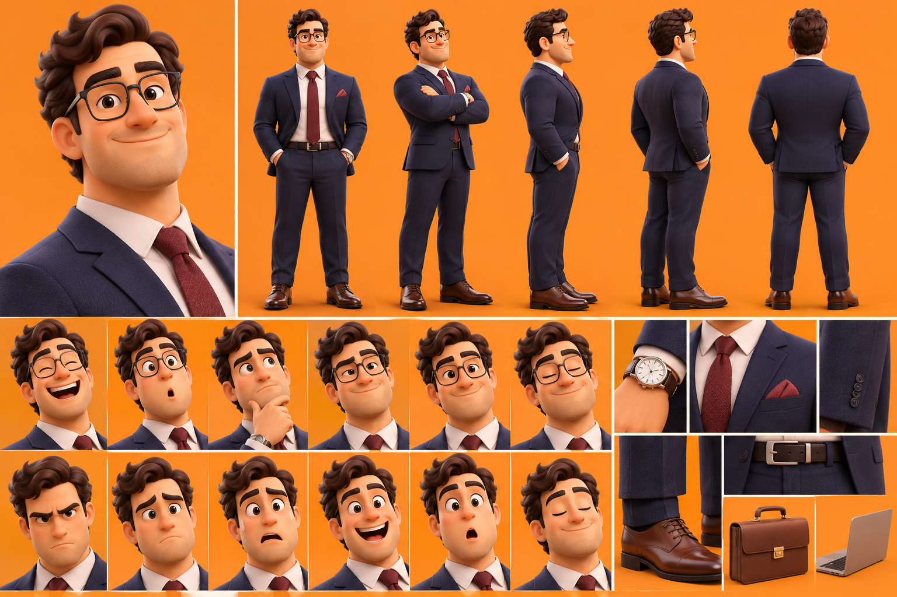

# Le Businessman — Alex

La planche sert à garder **tous les détails, toujours**. On ne change rien au dessin.

## Rôle
- Représente le monde professionnel, les affaires et la réussite.
- Explique les stratégies, l'argent, la carrière et la productivité.
- Partage des conseils sur les décisions financières et professionnelles.
- Peut illustrer les erreurs de raisonnement liées à l'ambition ou au travail.
- Apporte une vision rationnelle aux discussions.

## Personnalité
Ambitieux, intelligent, organisé et analytique. Aime comprendre les mécanismes économiques, prendre des décisions stratégiques et trouver des solutions efficaces. Parfois trop sérieux, perfectionniste ou obsédé par la réussite.

## Apparence (d'après la planche, qui fait foi)
- Homme adulte, élégant, carrure solide.
- Cheveux bruns ondulés, coiffés avec volume ; rasé (pas de barbe).
- Lunettes rectangulaires à monture foncée, sourcils épais, sourire sympathique.
- Costume bleu marine, chemise blanche, cravate bordeaux à motif fin, pochette bordeaux.
- Ceinture en cuir brun à boucle argentée, montre à cadran blanc et bracelet cuir brun.
- Chaussures richelieu en cuir marron.
- Accessoires : mallette en cuir marron, ordinateur portable gris.

Différences avec la description écrite (non retenues, la planche fait foi) : cardigan beige, chemise bleu clair, pantalon brun, barbe, carnet en cuir.

## Expressions caractéristiques
Sourire confiant, regard analytique derrière ses lunettes, expression concentrée, sourcil levé quand il doute, petit sourire satisfait quand il trouve une solution, air perplexe quand une stratégie échoue.

## Voix retenue
ElevenLabs **« Terence – Warm, Confident, and Friendly »** (`voice_id: hnhGxwvHP8fc469w51rM`), modèle `eleven_v4`, anglais américain (public USA), 1 seule prise.
Voix existante, non testée (pour ne pas consommer) : chaleureuse, confiante, articulée, posée et réfléchie, professionnelle mais accessible.

## Méthode
Vidéo IA (Kling 2.5 Turbo) à partir d'une image découpée dans la planche, sans changer aucun détail : `serie-papa/businessman_depart_16x9.png` (mains dans les poches, fond prolongé sans bande visible).
