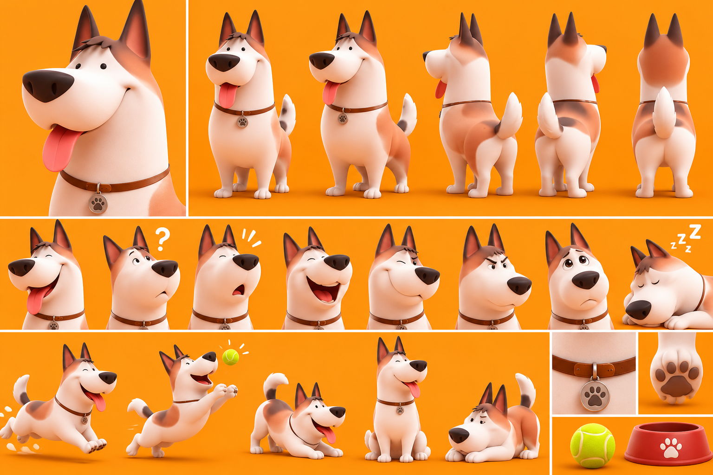

# Le Chien — Max

La planche sert à garder **tous les détails, toujours**. On ne change rien au dessin.

## Rôle
- Compagnon fidèle de la famille.
- Source d'humour et de situations comiques.
- Protecteur des enfants.
- Apporte de l'émotion, de la tendresse et de la spontanéité.

## Histoire
Le chien fidèle de la famille. Toujours auprès des enfants, il adore jouer, courir après les balles et recevoir des caresses. Très intelligent, il comprend beaucoup de choses, mais ses réactions instinctives provoquent souvent des situations amusantes.

## Personnalité
Fidèle, affectueux, joueur, protecteur et parfois maladroit.

## Apparence (d'après la planche, conforme à la description)
- Chien cartoon 3D de type berger stylisé, corps trapu et arrondi.
- Pelage blanc crème avec taches marron-roux (dos, flancs, tête) et petite mèche brune sur le front.
- Grandes oreilles pointues, intérieur rosé et pointes brun foncé.
- Gros museau arrondi, grosse truffe brun foncé, petits yeux noirs expressifs, langue rose souvent sortie.
- Queue blanche touffue avec taches brun foncé.
- Collier en cuir brun avec médaille ronde argentée gravée d'une patte.
- Pattes robustes, coussinets bruns.
- Accessoires : balle de tennis jaune, gamelle rouge avec une patte blanche.

## Expressions caractéristiques
Langue sortie, tête penchée avec « ? », surprise, grand rire, clin d'œil, air fâché, regard triste, sommeil (« zzz »). Poses : course, saut pour attraper la balle, invitation au jeu (avant du corps baissé), assis, couché boudeur.

## Voix et sons
Pas de langage humain : aboiements expressifs, petits grognements amusants, gémissements tristes, halètement.
À produire avec les **effets sonores ElevenLabs** (texte vers son), au moment du montage, uniquement quand une vidéo en a besoin.

## Méthode
Vidéo IA (Kling 2.5 Turbo) à partir d'une image découpée dans la planche, sans changer aucun détail : `serie-papa/chien_depart_16x9.png` (debout, langue sortie ; fond prolongé sans bande visible).
