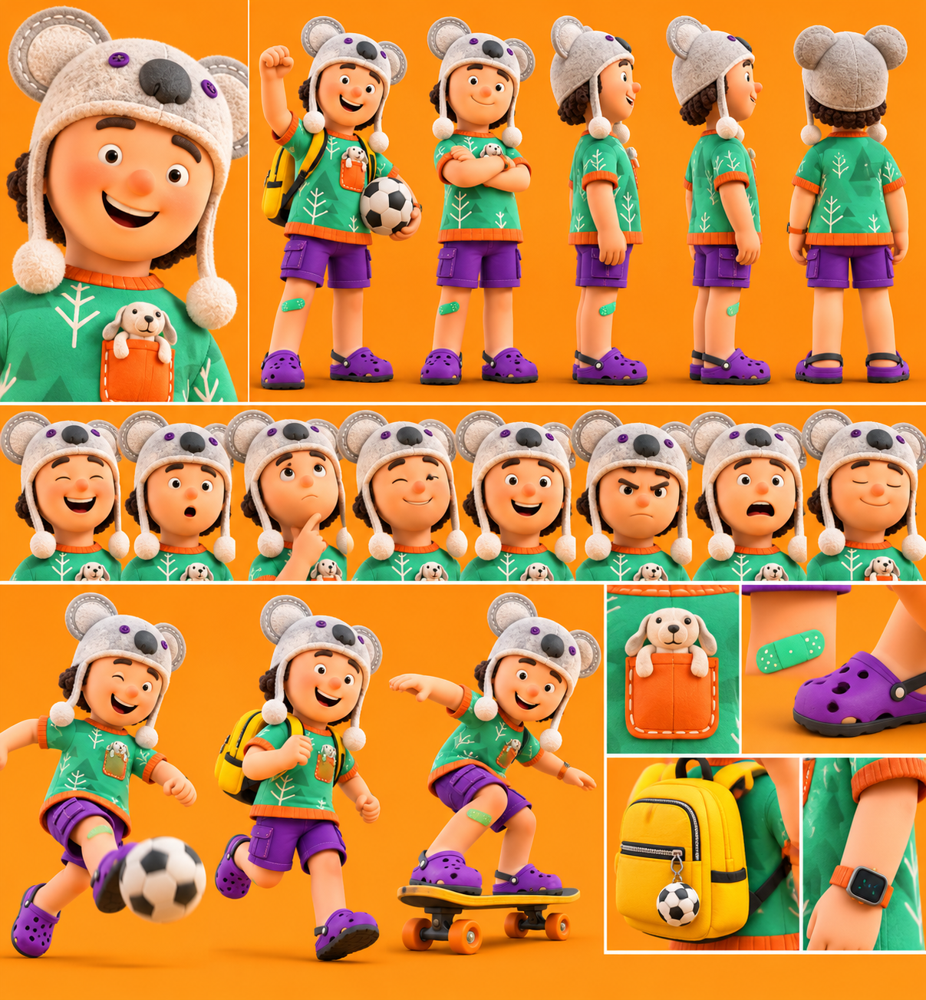

# L'Enfant actif — Léo (6–8 ans)

La planche sert à garder **tous les détails, toujours**. On ne change rien au dessin.

## Rôle
Apporter de l'énergie, de l'humour et de la spontanéité aux histoires. Il représente l'enfance active, la curiosité, le jeu et l'aventure.

## Histoire
Petit garçon plein d'énergie qui adore le football, le skateboard et les activités physiques. Il transforme chaque journée en aventure. Malgré son enthousiasme débordant, il reste attachant, spontané et parfois maladroit.

## Personnalité
Énergique, joyeux, curieux, sportif et aventureux. Toujours prêt à bouger et à découvrir quelque chose.

## Apparence (d'après la planche, qui fait foi)
- Petit garçon au visage rond et souriant, joues rosées, cheveux bruns bouclés.
- Bonnet en feutre gris clair en forme de **koala** : grandes oreilles rondes, gros nez noir, petits boutons violets, cordons avec pompons blancs.
- T-shirt vert à motifs d'arbres et sapins blancs, bords orange côtelés, poche orange cousue d'où sort un **petit chien** en peluche.
- Short cargo violet, pansement vert sur le genou.
- Sabots violets à trous avec bride noire.
- Sac à dos jaune avec un porte-clés ballon de foot.
- Montre connectée à bracelet orange.
- Accessoires : ballon de football, skateboard jaune à roues orange.

Différences avec la description écrite (la planche fait foi) : le bonnet est un koala gris (pas un ours beige) et la peluche dans la poche est un petit chien (pas un ours).

## Expressions caractéristiques
Grand rire, bouche en « o », réflexion (doigt sur le menton), clin d'œil, grand sourire, moue fâchée, air paniqué, calme les yeux fermés. Poses d'action : poing levé, tir au but, course avec le sac, skateboard.

## Voix retenue
ElevenLabs **« Teddy Twinkle – Cute Cartoon Boy »** (`voice_id: XjGYkUkzth8BPs29fmcV`), modèle `eleven_v4`, anglais américain (public USA), 1 seule prise.
Voix existante, non testée (pour ne pas consommer) : petit garçon de dessin animé, enjoué, joyeux et attachant.

## Méthode
Vidéo IA (Kling 2.5 Turbo) à partir d'une image découpée dans la planche, sans changer aucun détail : `serie-papa/enfant_depart_16x9.png` (poing levé, ballon sous le bras, sac à dos ; fond prolongé sans bande visible).
