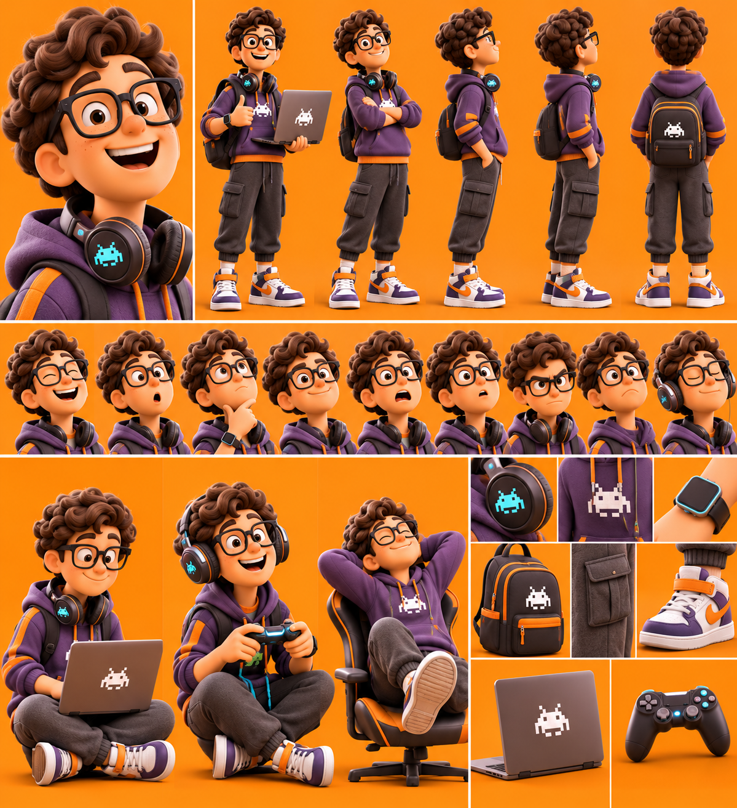

# Le Geek — Adam (13–15 ans)

La planche sert à garder **tous les détails, toujours**. On ne change rien au dessin.

## Rôle
Représenter la génération numérique, les jeux vidéo, l'intelligence technologique et les habitudes des adolescents modernes.

## Histoire
Adolescent passionné par les jeux vidéo, l'informatique et les nouvelles technologies. Passe beaucoup de temps devant son ordinateur, joue en ligne et adore les nouveaux gadgets. Derrière son apparence de geek se cache un garçon sensible, imaginatif et attachant.

## Personnalité
Intelligent, passionné de technologie, gamer, créatif, un peu introverti mais très drôle.

## Apparence (d'après la planche, conforme à la description)
- Adolescent au visage rond et sympathique, taches de rousseur, cheveux bruns très bouclés.
- Grandes lunettes noires rectangulaires.
- Hoodie violet avec bandes et cordons orange, motif pixel blanc (petit extraterrestre) sur la poitrine.
- Pantalon cargo gris foncé resserré aux chevilles, chaussettes blanches.
- Sneakers montantes violettes, blanches et orange avec bride orange (**sans logo** : la virgule de marque de la planche est masquée ; toujours préciser « no logo » dans les prompts).
- Casque audio noir et orange avec symbole pixel turquoise lumineux, autour du cou.
- Sac à dos noir et orange avec motif pixel blanc, montre connectée noire.
- Accessoires : ordinateur portable gris avec motif pixel, manette de jeu noire à touches lumineuses, chaise gamer noire et orange.

## Expressions caractéristiques
Grand rire, bouche en « o », réflexion (main au menton), sourire en coin, air paniqué, moue sceptique, air renfrogné, casque sur les oreilles en souriant. Poses : pouce levé avec l'ordinateur, assis en tailleur avec l'ordinateur ou la manette, avachi dans la chaise gamer.

## Voix retenue
ElevenLabs **« Aaron – Conversational American Male »** (`voice_id: B6uUx2p7cRgxseOUyP6P`), modèle `eleven_v4`, anglais américain (public USA), 1 seule prise.
Voix existante, non testée (pour ne pas consommer) : jeune, sincère, énergique et naturelle, « garçon d'à côté », pensée pour l'animation, les jeux vidéo et la tech.

## Méthode
Vidéo IA (Kling 2.5 Turbo) à partir d'une image découpée dans la planche, sans changer aucun détail : `serie-papa/geek_depart_16x9.png` (pouce levé, ordinateur en main ; fond prolongé sans bande visible ; logo des sneakers masqué).
