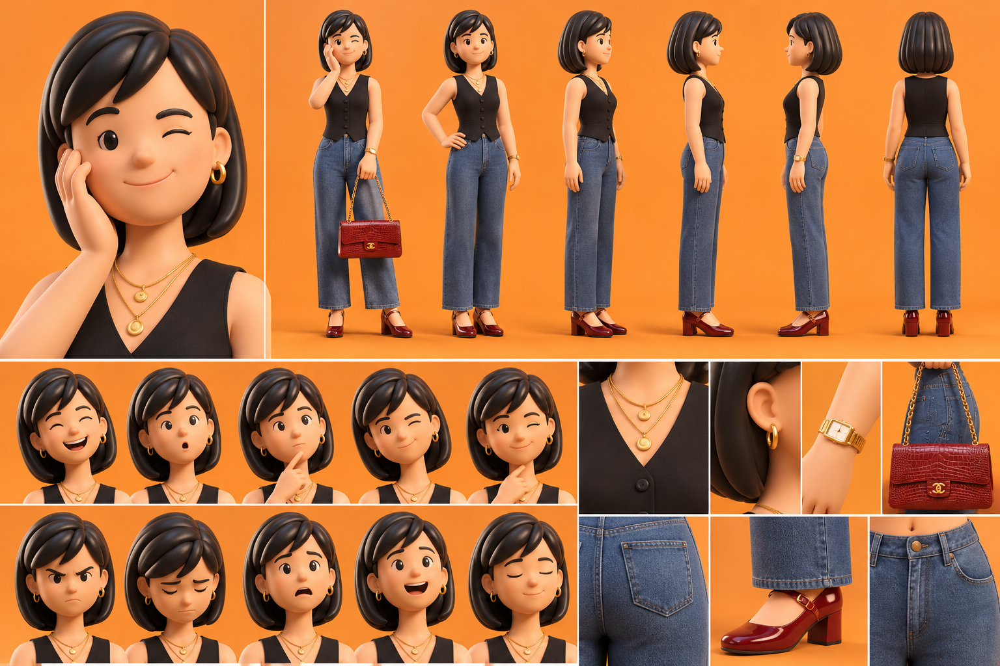

# La Maman — Sophie

La planche sert à garder **tous les détails, toujours**. On ne change rien au dessin.

## Rôle
- Représente la maman et l'équilibre émotionnel de la famille.
- Intervient dans les situations familiales et éducatives.
- Conseille, rassure et recadre les enfants.
- Apporte une perspective féminine et pratique aux discussions.
- Peut être drôle, ironique ou parfois exaspérée par les comportements de son mari et des enfants.

## Personnalité
Intelligente, élégante, affectueuse et attentive. Caractère affirmé, mais douce avec sa famille. Comprend vite les situations et gère les problèmes avec calme et humour.

## Apparence (d'après la planche)
- Visage doux et souriant, cheveux noirs au carré avec mèche sur le côté, yeux bruns.
- Silhouette féminine, proportions stylisées 3D.
- Haut noir sans manches en forme de gilet, col en V, boutons noirs.
- Jean bleu large et long.
- Chaussures rouge bordeaux vernies à talon carré et bride.
- Bijoux dorés : créoles, deux colliers à médaillons, montre dorée carrée.
- Sac à main rouge bordeaux effet croco, chaîne dorée.

## Expressions caractéristiques
Sourire complice, clin d'œil malicieux (main sur la joue, comme la planche), regard étonné, expression désapprobatrice, sourire tendre, regard sérieux quand elle recadre.

## Voix retenue
ElevenLabs **« Marie – Warm & Expressive »** (`voice_id: Bv9P233zucGXSrswwl5g`), modèle `eleven_v4`, anglais américain (public USA), 1 seule prise.
Voix existante, non testée (pour ne pas consommer) : chaleureuse, naturelle, expressive, avec de la palette pour l'humour, la tendresse et la fermeté.
L'accent québécois de la description ne s'applique pas : la série est en anglais pour les USA.

## Méthode
Même méthode que Papa : vidéo IA (Kling 2.5 Turbo) à partir d'une image découpée dans la planche, sans changer aucun détail : `serie-papa/maman_depart_16x9.png` (fond prolongé sans bande visible).
