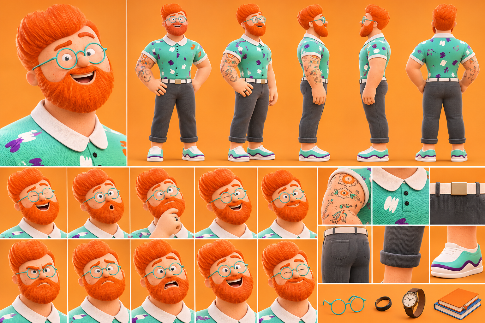

# Papa — personnage principal



## Rôle
Le père de famille et l'adulte moderne. C'est le personnage central, qui permet d'aborder :
- la psychologie humaine ;
- la vie familiale et les relations ;
- le travail et les difficultés financières ;
- le stress et le bien-être ;
- les habitudes et les contradictions humaines ;
- les situations comiques et émotionnelles du quotidien.

## Histoire
Homme adulte, mari et père de famille. Il traverse les situations ordinaires de la vie moderne : travail, responsabilités familiales, argent, stress, relations humaines et émotions.
Par ses expériences, il découvre les comportements humains, les contradictions de la société et les petits problèmes du quotidien. Il partage ses réflexions avec humour, intelligence et parfois une certaine maladresse.

## Personnalité
Intelligent, observateur, réfléchi, bienveillant, parfois anxieux, sarcastique et drôle sans le vouloir.

## Voix
- Timbre : masculin, médium-grave, chaleureux.
- Âge vocal : environ 40–45 ans.
- Style : naturel, calme, expressif, légèrement humoristique.
- Débit : modéré, avec des pauses pour accentuer les réflexions.
- Émotions : passe du sérieux à l'ironie, de la frustration à la tendresse.
- Particularité : voix rassurante, intelligente, légèrement fatiguée par les responsabilités.

## Apparence — d'après la planche de référence
Style : personnage 3D cartoon cinématographique, chaleureux, expressif, légèrement caricatural.

| Élément | Détail |
|---|---|
| Silhouette | Homme adulte, carrure solide, épaules larges |
| Cheveux | Roux orangé, épais, coiffés en banane volumineuse vers l'arrière |
| Barbe | Rousse, pleine et fournie, avec moustache |
| Visage | Taches de rousseur, grands yeux bleus, sourcils roux marqués, nez rond |
| Lunettes | Rondes, monture fine turquoise |
| Haut | Polo turquoise menthe, col blanc arrondi, boutons noirs, motifs de pinceau violets, blancs et orange |
| Bras | Tatouages old school sur l'avant-bras droit (fleurs, oiseau, ancre) |
| Ceinture | Blanche, boucle dorée carrée |
| Pantalon | Gris anthracite, bas retroussé |
| Chaussures | Baskets blanches à vague turquoise et violette |
| Accessoires | Lunettes, bague noire, montre bracelet cuir brun, livres |

Palette :
- Orange de fond `#F39A3A` (environ).
- Roux `#E8642A` (environ).
- Turquoise `#5CC9AE` (environ).
- Violet `#6B3FA0` (environ).
- Gris anthracite `#4A4D52` (environ).
- Blanc cassé `#F4F1EA` (environ).

Expressions de la planche : rire, surprise (bouche en « o »), réflexion (main au menton), clin d'œil, sourire content, colère, inquiétude, panique, grand rire, clin d'œil complice.

## Version retenue : mélange des deux (style 2D « nouille »)
Code : `moteur/rig_papa.js` (`makePapa`). Test : `moteur/papa.html` + `moteur/papa_test.js`.
- **Tête (planche)** : banane rousse, barbe rousse fournie avec moustache, taches de rousseur, lunettes rondes turquoise.
- **Tenue (texte)** : cardigan beige à boutons bruns, chemise bleu clair, pantalon brun foncé, chaussures en cuir brun.
- **Accessoires** : montre (poignet gauche), carnet orange et bleu.
- **Poses** : `stand`, `walk`, `wave`, `think` (poing sur la barbe, carnet), `laugh`, `shrug`, `worried`, `angry`.

Rendu du test (fond crème, 5 s, sans son) :
```bash
cd moteur && PAGE=papa.html THEME=creme node render_par.js /dossier/papa_test.mp4 3
```
