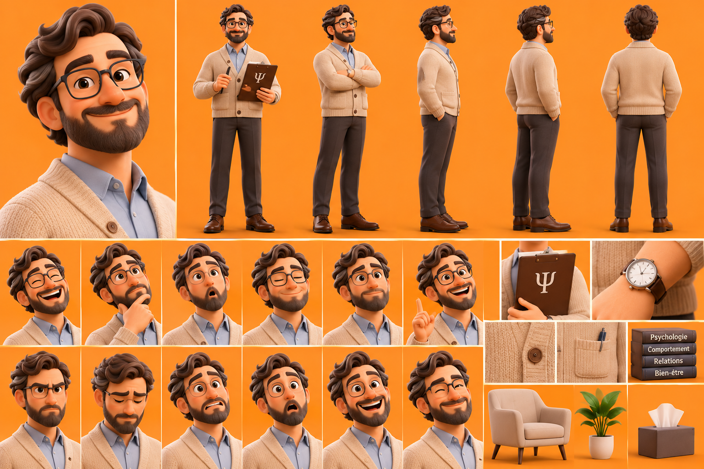

# Le Psychologue — Dr. Gabriel

La planche sert à garder **tous les détails, toujours**. On ne change rien au dessin.

## Rôle
- Explique la psychologie humaine et les comportements.
- Analyse les émotions, les relations et les réactions.
- Décrypte les mécanismes inconscients.
- Aide les personnages à comprendre leurs problèmes.
- Apporte des explications psychologiques aux situations quotidiennes.
- Peut intervenir avec humour pour analyser les comportements absurdes des autres personnages.

## Personnalité
Calme, intelligent, empathique et observateur. Patient, réfléchi, humour subtil. Ne juge pas, mais sait révéler les contradictions avec une remarque pertinente.

## Apparence (d'après la planche, conforme à la description)
- Homme adulte, sympathique et rassurant, apparence soignée et un peu intellectuelle.
- Cheveux bruns épais, ondulés et volumineux, barbe brune bien entretenue.
- Lunettes rectangulaires à monture noire, grands yeux expressifs, sourcils épais.
- Cardigan beige en maille à boutons bruns et poches, chemise bleu clair.
- Pantalon brun foncé, chaussures en cuir marron, montre à cadran blanc et bracelet cuir brun.
- Accessoires : porte-documents en cuir brun avec le symbole Ψ, stylo, livres (Psychologie, Comportement, Relations, Bien-être), fauteuil beige, plante, boîte de mouchoirs.

## Expressions caractéristiques
Sourire bienveillant, regard attentif, doigt sur le menton, sourcil levé, petit sourire ironique, air étonné devant un comportement irrationnel, regard calme et rassurant.

## Voix retenue
ElevenLabs **« Christian – Warm, Steady, Unhurried »** (`voice_id: x6vtE4TgM6a0on8gvQac`), modèle `eleven_v4`, anglais américain (public USA), 1 seule prise.
Voix existante, non testée (pour ne pas consommer) : chaude, posée, sans précipitation, au calme attentif d'un thérapeute (c'est sa description officielle).
L'accent québécois de la description ne s'applique pas : la série est en anglais pour les USA.

## Méthode
Vidéo IA (Kling 2.5 Turbo) à partir d'une image découpée dans la planche, sans changer aucun détail : `serie-papa/psychologue_depart_16x9.png` (porte-documents Ψ et stylo en main, fond prolongé sans bande visible).
