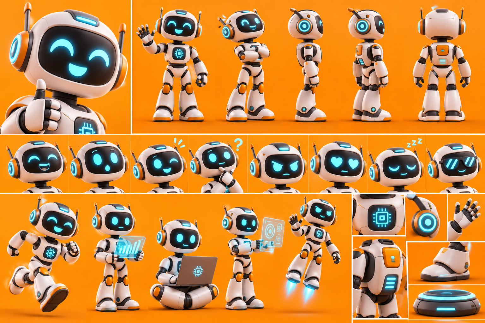

# Le Robot — ROBI

La planche sert à garder **tous les détails, toujours**. On ne change rien au dessin.

## Rôle
- Assistant technologique des personnages.
- Apporte des explications, des informations et des solutions.
- Introduit l'intelligence artificielle et les nouvelles technologies.
- Ajoute de l'humour grâce à ses réactions parfois inattendues.

## Histoire
Robot intelligent conçu pour accompagner les humains au quotidien. Intelligence artificielle avancée, grande capacité d'analyse et sens de l'humour surprenant. Il apprend peu à peu à comprendre les émotions, les comportements et les relations humaines.

## Personnalité
Intelligent, serviable, drôle, curieux, parfois maladroit dans sa compréhension des émotions humaines.

## Apparence (d'après la planche, conforme à la description)
- Robot humanoïde compact, design futuriste, sympathique et non menaçant.
- Tête arrondie blanche avec grand écran noir ; yeux et bouche cyan lumineux, très expressifs.
- Barre lumineuse cyan sur le haut de la tête, deux antennes courtes à embout orange.
- Oreilles circulaires lumineuses cyan cerclées d'orange.
- Corps blanc et gris clair, articulations noires, genouillères et détails orange.
- Écran cyan avec symbole de puce électronique sur la poitrine ; panneau orange et voyants cyan dans le dos.
- Mains articulées blanc et noir, grands pieds robotiques blanc, noir et orange avec voyant cyan.
- Accessoires : ordinateur portable avec puce, écrans holographiques (graphiques, cibles), réacteurs aux pieds pour voler, base de recharge lumineuse.

## Expressions caractéristiques (sur l'écran)
Sourire aux yeux fermés, surprise, clin d'œil, point d'interrogation, colère, yeux en cœur, sommeil (« zzz »), lunettes de soleil pixel. Poses : salut de la main, bras croisés, pouce levé, course, hologrammes, assis avec l'ordinateur, vol avec réacteurs.

## Voix retenue
ElevenLabs **« Vector – Tec Voice »** (`voice_id: NoiYxL9g25M4orC8Q0ls`), modèle `eleven_v4`, anglais américain (public USA), 1 seule prise.
Voix existante, non testée (pour ne pas consommer) : moderne, claire, précise, légèrement robotique, style assistant tech de science-fiction.
Les petits effets sonores numériques de la description se feront au montage.

## Méthode
Vidéo IA (Kling 2.5 Turbo) à partir d'une image découpée dans la planche, sans changer aucun détail : `serie-papa/robot_depart_16x9.png` (salut de la main, sourire ; fond prolongé sans bande visible).
