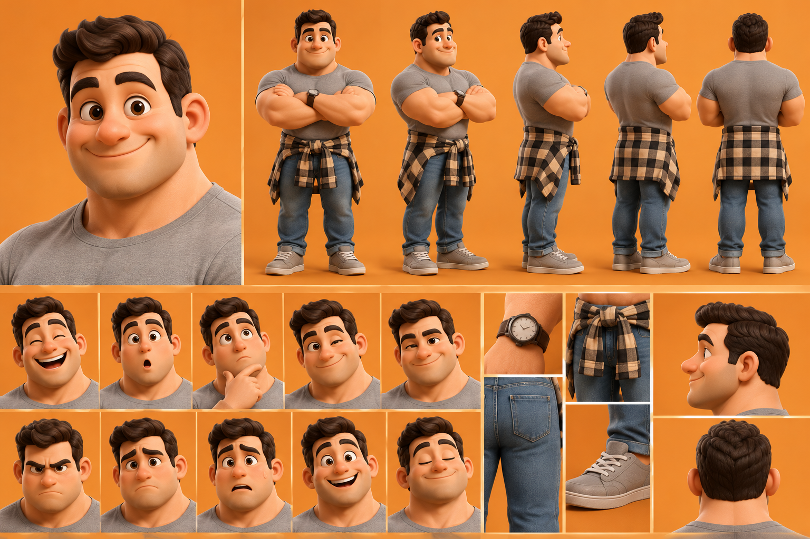
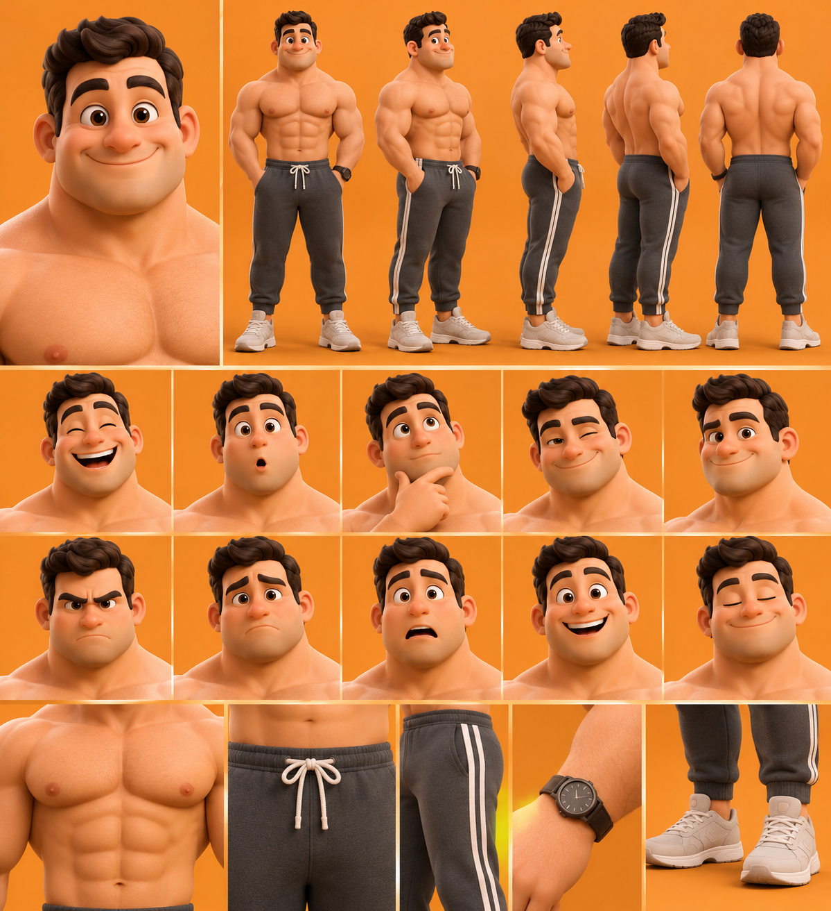

# Le Sportif




## Rôle
Jeune homme athlétique, énergique et sympathique. Il représente :
- le sport et la musculation ;
- la santé physique et les habitudes sportives ;
- la motivation et la discipline ;
- la confiance corporelle ;
- les défis physiques ;
- l'humour autour de l'entraînement et du mode de vie actif.

## Histoire
Jeune adulte passionné par le sport, l'entraînement et le développement personnel. Il aime repousser ses limites, rester en forme et relever des défis.
Il incarne la motivation, la discipline et la confiance en soi, mais aussi les difficultés : régularité, fatigue, image corporelle.

## Personnalité
Motivé, sociable, optimiste, discipliné, parfois impatient, compétitif et drôle.

## Voix retenue
ElevenLabs **« Knox – Bro-Dude + Gym Feels »** (`voice_id: cgLpYGyXZhkyalKZ0xeZ`), modèle `eleven_v4`, anglais américain, 1 seule prise.
Voix existante : jeune, énergique, drôle et chaleureuse, passe de l'enthousiasme à l'émotion.
Description demandée : masculin, médium légèrement grave, 25–30 ans, dynamique, confiant, chaleureux, motivant sans être agressif.
Essai : `serie-papa/voix/sportif_essai_voix.mp3` (7 s, environ 92 crédits).

## Apparence (flat design, fidèle aux planches)
- Silhouette : épaules très larges, gros bras, jambes courtes, carrure trapue.
- Tête : grosse tête ronde, joues pleines, grandes oreilles, grands yeux bruns, sourcils épais, nez rond.
- Cheveux : bruns foncés, courts sur les côtés, volume coiffé vers le haut.
- Montre noire au poignet gauche dans les deux tenues.

| Tenue | Détail |
|---|---|
| **Habillé** (`torse: 0`) | T-shirt gris ajusté, jean bleu retroussé, chemise à carreaux beige et noir nouée à la taille, sneakers grises |
| **Torse nu** (`torse: 1`) | Pectoraux et abdominaux, jogging gris foncé à bandes blanches et cordon blanc, sneakers beige clair |

## Animation
Code : `serie-papa/sportif.js` (`makeSportif`). Test : `serie-papa/sportif_test_5s.js`.
- Poses : `cross` (bras croisés, comme la planche), `pockets` (mains dans les poches, comme la planche torse nu), `stand`, `wave`, `flex` (double biceps), `think`, `laugh`, `surprise`, `wink`, `angry`, `worried`, `calm`.
- Changement de tenue : clé `{ torse: 1 }` (dans le test, pendant un demi-tour sur place).

Rendu du test (5 s, sans son) :
```bash
cd moteur && SCENE=sportif_test_5s PAGE=../serie-papa/index.html node render_par.js /dossier/sportif_test.mp4 3
```
